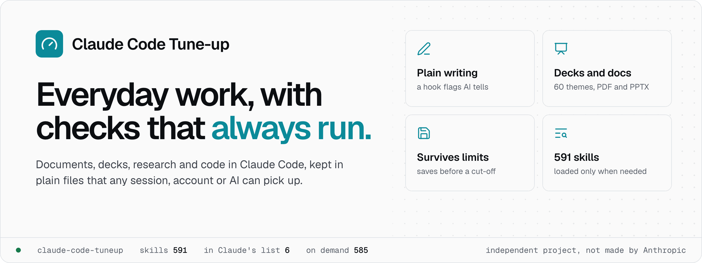
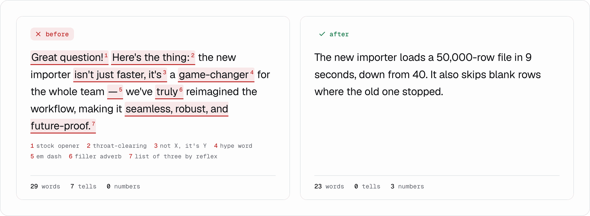
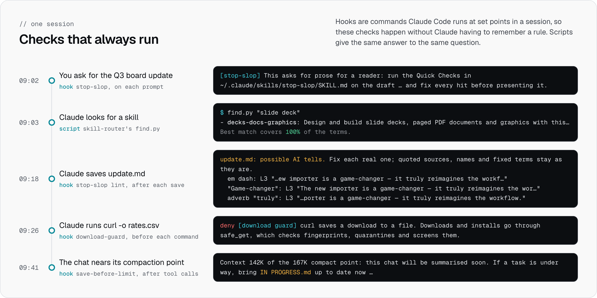
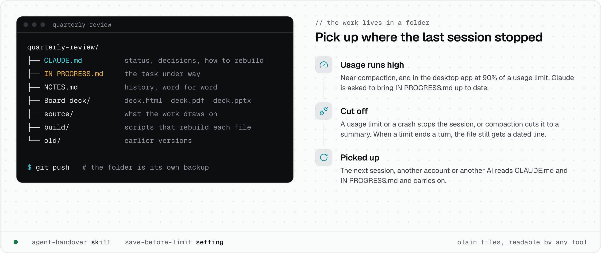
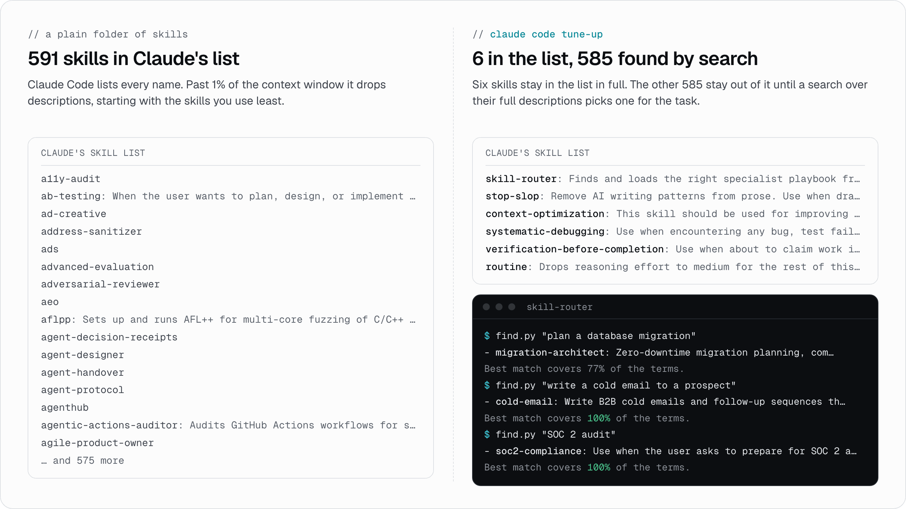
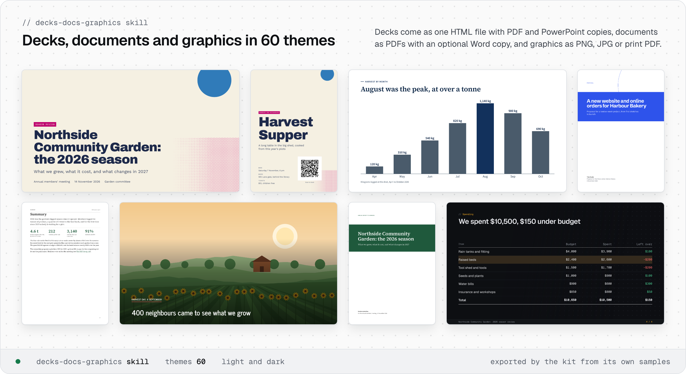

<picture>
  <source media="(prefers-color-scheme: dark)" srcset="assets/hero-dark.png">
  
</picture>

# Claude Code Tune-up

Skills, hooks and settings that set Claude Code up for documents, decks, research and code. Your work stays in plain files on your own computer, hooks run the same checks in every session, and 591 skills stay out of Claude's way until a task needs one.

This is an independent project, not made by Anthropic. Its skills come from 16 open-source collections, this one among them, and each keeps its author's licence and credit (see [Credits](#credits)).

## Quick start

```bash
git clone https://github.com/dini-2000/claude-code-tuneup.git
cd claude-code-tuneup
./setup.sh
```

`setup.sh` asks whether to install the 29 essentials or all 591 skills, and which settings to turn on. Restart Claude Code afterwards. [Install](#install) covers Windows and the desktop app.

## Why Claude Code for everyday work

Claude Code works in a folder on your own computer, which suits a report, a deck or a research project as well as it suits code.

- Your work is a folder of plain files: drafts, sources, the scripts that build each output, and notes. Any editor opens them, git keeps their history, and your usual backup covers them.
- Any session can pick up the work. A `CLAUDE.md` in each project says what the work is, what was decided and how to rebuild it, and `IN PROGRESS.md` says where the current task stands. A new session, a second account or another AI tool reads the same files and carries on.
- Hooks run whether or not Claude remembers a rule. Claude Code runs them at set points, such as before a command or after a file is saved, so a check happens every time.
- Scripts give the same result each run. A deck or a chart built from a script comes out the same way next week, so a fix stays fixed.
- The outputs are real PDF, PowerPoint and Word files, made by tools on your machine. Claude can render each one to images and look at every page before you open it.
- One setup in `~/.claude` serves the terminal, the desktop app's Code tab and the IDE extensions.

## What you get

### Plain writing

<picture>
  <source media="(prefers-color-scheme: dark)" srcset="assets/writing-dark.png">
  
</picture>

The stop-slop skill lists the patterns that make text read as machine-written. Its setting loads the quick checks at the start of each session, reminds Claude to run them when a prompt asks for prose, and lints the Markdown, HTML and text files Claude saves, naming each tell it finds. It leaves Claude's own notes, such as `CLAUDE.md`, alone.

### Checks that always run

<picture>
  <source media="(prefers-color-scheme: dark)" srcset="assets/session-dark.png">
  
</picture>

Each step above is real output from the tune-up. The skill search comes from the `CLAUDE.md` block and the rest are hooks, which `settings/install.py` turns on and off without touching your own `settings.json` entries.

### Work that survives limits

<picture>
  <source media="(prefers-color-scheme: dark)" srcset="assets/handover-dark.png">
  
</picture>

The agent-handover skill sets out these files, when to update them and how a fresh session picks up. The save-before-limit setting asks Claude to bring `IN PROGRESS.md` up to date as the chat nears compaction and, in the desktop app, at 90% and 97% of a usage limit. When a limit ends a turn, it still adds a dated line to the file, so the next session knows where the work stopped.

The skill also comes with two scripts for your AI to fit to your own folders: `handover.py` shows every project's unfinished work at the start of each session and points a session that follows a `/clear` at the right files, and `backup.py` keeps the workspace in a private git repository, checking for secrets before each commit. [The setup guide](skills/agent-handover/setup.md) takes your AI through it step by step.

### 591 skills, 6 in Claude's list

<picture>
  <source media="(prefers-color-scheme: dark)" srcset="assets/skills-dark.png">
  
</picture>

Claude Code lists the name of every installed skill and adds descriptions until they fill 1% of the context window, dropping the least-used first. The tune-up keeps six skills in that list. The other 585 stay out of it, and at the start of a substantive task skill-router's `find.py` ranks their descriptions against the task, so Claude reads a skill only when one fits.

### Decks, documents and graphics

<picture>
  <source media="(prefers-color-scheme: dark)" srcset="assets/kit-dark.png">
  
</picture>

The decks-docs-graphics skill builds slide decks, paged documents and graphics in 60 themes, or in one made from your own logo or brand guide. A deck comes as one HTML file with PDF and PowerPoint copies, a document as a PDF with an optional Word copy, and a graphic as PNG, JPG or a print PDF. [More on the kit](#decks-docs-and-graphics).

## Spend less of your limit

- `routine` drops Claude's effort to medium for the rest of a turn once only mechanical steps are left, such as notes, renames and commits. It is one of the six skills in Claude's list, so Claude calls it without being asked.
- `context-audit` measures what loads into every session (`CLAUDE.md` files, the memory index, connectors and their tools), moves history to `NOTES.md` word for word, shortens the memory index and suggests connectors to turn off. Ask for it when chats compact early or use up limits fast.
- The `CLAUDE.md` block asks Claude to search before reading, read only the part of a large file it needs and keep tool output small.
- The tune-up itself costs about 1,100 tokens a session: about 430 for the six listed skills and about 650 for the `CLAUDE.md` block. The stop-slop setting adds about 400 at session start and about 100 on each prompt that asks for writing, and a skill search costs about 200 per task.

---

## Install

**New to the command line?** Open the Claude Code desktop app (the Code tab in the Claude app), paste this repo's link, https://github.com/dini-2000/claude-code-tuneup, and ask Claude to install it for you. Claude reads this page, asks whether you want the essentials or every skill, and runs the steps below, asking before each command.

To install it yourself, follow the steps for your computer. Every command on this page runs in Terminal on a Mac or in Git Bash on Windows.

### Mac

Open Terminal (press Cmd+Space, type Terminal and press Return), then run:

```bash
git clone https://github.com/dini-2000/claude-code-tuneup.git
cd claude-code-tuneup && ./setup.sh
```

If macOS offers to install the command line developer tools, click Install, wait for it to finish and run the two lines again. The tools include Git and Python 3, which `setup.sh` needs.

### Windows

1. Install [Git for Windows](https://git-scm.com/downloads/win), which includes Git Bash, and [Python 3](https://www.python.org/downloads/windows/). In the Python installer, tick "Add python.exe to PATH" before you click Install.
2. Open Git Bash from the Start menu, then run:

```bash
git clone https://github.com/dini-2000/claude-code-tuneup.git
cd claude-code-tuneup && ./setup.sh
```

`setup.sh` finds Python as `python3`, `python` or `py -3`. Where this page says `python3`, use whichever of those works on your computer.

### Choosing what to install

`setup.sh` asks two questions: the essentials or every skill, and which settings to turn on. It copies the skills into `~/.claude/skills` next to any you already have. To answer up front, pass flags:

```bash
./setup.sh --essentials --settings=essentials
./setup.sh --all --settings=all
```

Already running an older copy of this collection? Follow [UPDATE.md](UPDATE.md): it removes the skills that were dropped and the per-prompt hooks older copies installed.

Restart Claude Code, then check that the skill search works:

```bash
python3 ~/.claude/skills/skill-router/find.py "write an implementation plan"   # writing-plans first
python3 ~/.claude/skills/skill-router/find.py "make a slide deck"              # decks-docs-graphics first (full install)
```

### What `setup.sh` does

- Copies the skills you chose into `~/.claude/skills`, and trims the skill index to match.
- Writes a block into `~/.claude/CLAUDE.md` between markers: short writing rules, token-saving rules, and a pointer to the on-demand skills. `--no-rules` keeps only the pointer.
- Turns on the settings you chose, after backing up `~/.claude/settings.json`, and copies their scripts to `~/.claude/hooks/claude-code-tuneup`.
- Removes the per-prompt hooks that older copies added.
- Downloads nothing. `--with-massgen` is the one optional extra; `--uninstall` removes the block and the hooks.

---

## The essentials

The list lives in [`essentials.txt`](essentials.txt). Edit it before running `setup.sh --essentials` to make your own pack.

| Area | Skills |
|---|---|
| Finding skills, usage and handovers | `skill-router`, `context-optimization`, `routine`, `context-audit`, `agent-handover` |
| Planning and building | `brainstorming`, `grill-me`, `writing-plans`, `executing-plans`, `subagent-driven-development`, `using-git-worktrees`, `test-driven-development`, `systematic-debugging`, `verification-before-completion`, `requesting-code-review`, `receiving-code-review`, `finishing-a-development-branch` |
| Code quality | `karpathy-coder`, `code-reviewer`, `focused-fix`, `codebase-onboarding` |
| Front end and testing | `frontend-design`, `webapp-testing` |
| Writing, research and documents | `stop-slop`, `deep-research`, `research-summarizer`, `doc-coauthoring` |
| Extending Claude | `write-a-skill`, `mcp-builder` |

The full install adds Decks, Docs and Graphics and skills for finance and market data, strategy and board advice, SEO and marketing, sales, product, cloud and DevOps, security and compliance, design, data and more. [`skills/skill-router/INDEX.md`](skills/skill-router/INDEX.md) lists them all by area.

## Decks, Docs and Graphics

`skills/decks-docs-graphics` is a design kit made for the tune-up. It builds slide decks, paged PDF documents and graphics in 60 themes, or in a theme made from your own logo, brand guide or PowerPoint template. A deck comes out as one HTML file with its PDF and an editable PowerPoint that matches it slide for slide. Documents (reports, proposals, letters, CVs, invoices, newsletters) come out as print-quality PDFs, with a CMYK PDF/X-4 copy for a print shop and an editable Word copy when you want one. Graphics (social posts, banners, posters, invitations, business cards) come out as PNG, JPG and PDF at each platform's size. A style picker in the browser lets you compare themes before you choose. Before a file goes out, the kit checks it where it will be opened: in PowerPoint or Word on a Mac, or, once you connect Claude to Google Drive, in Google Slides, Docs or Sheets, using one test folder in your Drive.

A full install includes it. The essentials leave it out, since its fonts, flags and maps make it about 67 MB; to add it on its own, copy `skills/decks-docs-graphics` into `~/.claude/skills`, or clone [its own repository](https://github.com/dini-2000/decks-docs-graphics) there. It needs Python 3 with `pymupdf`, `python-pptx` and `Pillow`, and Google Chrome, Chromium or Edge; LibreOffice is optional, for the PowerPoint and Word checks. Run `python3 tools/selftest.py --quick` from its folder once to check it works on your computer. Then call it as `/decks-docs-graphics`, or ask for a deck, report or poster: the skill search lists it among the closest matches. [Its README](skills/decks-docs-graphics/README.md) lists every tool, theme and known limit.

## Settings

Hooks that run in every session. [`settings/README.md`](settings/README.md) explains each one and how to turn it on or off.

| Setting | Tier | What it does |
|---|---|---|
| `stop-slop` | essential | Keeps Claude's writing plain: the stop-slop checks at session start, a reminder on writing requests, and a lint on the prose files Claude saves. |
| `save-before-limit` | essential | Asks Claude to bring `IN PROGRESS.md` up to date before the chat is compacted or a usage limit ends the session. |
| `dictation-check` | optional | Flags prompts that read as speech-to-text, so Claude reads them for intent and checks the words a mishearing would change. |
| `security-guidance` | optional | Stops an edit the first time it brings in one of 12 common security mistakes. Needs the `security-guidance` skill. |
| `download-guard` | optional | Sends Claude's downloads and installs through `safe_get.py`, which checks fingerprints, quarantines and screens each file before use. Built and tested on macOS. |

---

## How the skill search works

Claude Code puts every installed skill's name in Claude's context, with as many descriptions as fit in 1% of the context window; when they don't all fit, it drops the descriptions of the skills used least ([Claude Code docs](https://code.claude.com/docs/en/skills)). In a plain folder of 591 skills, most would show as bare names, which give Claude little to choose by. The tune-up works the other way round.

**1. Six skills in Claude's list.** `skill-router`, `stop-slop`, `context-optimization`, `systematic-debugging`, `verification-before-completion` and `routine` keep their names and descriptions in the list, about 430 tokens in all. The other 585 carry `disable-model-invocation: true`, which takes a skill out of Claude's context altogether; you can still run any of them as `/name`. The `CLAUDE.md` block adds about 650 tokens of writing and token rules that apply to every reply, and the rule for the skill search below.

**2. A brief search per task, about 200 tokens.** At the start of a substantive task (research, analysis, a document, deck or build), the block asks Claude to run `skill-router/find.py` with three to six key terms, batched with its first tool calls. The script ranks the catalog on your machine in about a tenth of a second and prints the five closest skills and how much of the task the best one covers. Below 45% it says no skill covers the task, and Claude carries on without one unless a skill's method clearly helps. Follow-ups, quick questions and chores skip the search.

**3. The index, read only when needed.** `skill-router/catalog.tsv` holds one line per skill, for `find.py` to rank and for grep. `skill-router/INDEX.md` groups the skills by area and lists each one's section headings.

To put a skill in Claude's list for good, delete the `disable-model-invocation: true` line from its `SKILL.md`. Keep that set small, since each listed skill costs context in every session.

---

## What differs from the sources

`_build/build_pack.py` builds the tree and checks its own work.

- **Missing files restored.** The source collections often shipped a skill's `SKILL.md` without the scripts, references and assets it names. This repo adds 2,191 of those files, each taken from the skill's own upstream repo at the commit its text was written against, checked against git's hash and screened for malware. [`_build/vendor/MANIFEST.tsv`](_build/vendor/MANIFEST.tsv) lists every one with its source, along with the files of the collections taken whole. No skill points at a file that isn't there.
- **Two families and a hook restored whole.** The `agenthub` family (parallel agents working in git worktrees) and the `autoresearch` family (an experiment loop that keeps what improves a metric) come straight from upstream, along with `security-guidance`. Their `/hub:x` and `/ar:x` commands are installed as `/hub-x` and `/ar-x`, so none replaces a Claude Code command. Upstream's `run_experiment.py` hard-resets whatever branch is checked out after a failed run; the copy here first checks that it is on an `autoresearch/` branch with every tracked change committed.
- **Three collections taken whole.** 14 skills from `mattpocock/skills`, 23 from `addyosmani/agent-skills` and 69 from `trailofbits/skills` come unchanged from upstream at pinned commits, screened like the rest. Trail of Bits' plugin-level files that some of its skills need (agent prompts, the `ct_analyzer` package, a README) sit inside those skills, and `differential-review`, `sharp-edges` and `dimensional-analysis` run their agents as general-purpose subagents when Trail of Bits' plugin isn't installed.
- **No skill pre-approves tools.** The build removes `allowed-tools` from every skill's frontmatter, so Claude Code asks you before a skill runs commands, as it would for any other task.
- **Agent files added.** 25 skills link to agent definitions (`agents/cs-*.md`) that never came with them. They are here, unchanged from upstream.
- **Fixes**, each listed with its base commit in [`_build/fixes/SOURCES.md`](_build/fixes/SOURCES.md): `banner-design`, `brand`, `design-system` and `epic-design` completed with the helpers their texts describe, and links to omitted skills replaced in `executing-plans`, `demo-video`, `full-page-screenshot`, `universal-scraping-architect` and `engineering-advanced-skills`, and links that pointed outside their skill fixed in `performance-optimization`, `security-and-hardening` and `yara-rule-authoring`.
- **15 skills omitted**, each with its reason in [`_build/omitted.tsv`](_build/omitted.tsv): stale copies of Anthropic's `docx`, `pdf`, `pptx`, `xlsx` and `skill-creator` (install Anthropic's maintained versions instead); an outdated `claude-api`; the six-skill self-improving family, which rewrites `MEMORY.md` and `CLAUDE.md` in competition with Claude Code's own memory; `using-superpowers`, which tells Claude it has no choice but to invoke a skill; and `notebooklm` and `browser-automation`, which rely on hiding automation from websites. A further 40 skills from the three collections taken whole were left out, with reasons in the same file: names that would replace Claude Code commands or skills already here, near-duplicates, skills that only work through their plugin's agents, commands or hooks, a Dockerfile that pipes install scripts into bash, and a few too narrow for a general collection.
- **41 duplicates dropped**: 12 byte-identical copies, and 29 pairs doing the same job with the fuller one kept, such as `seo-local` over `local-seo-manager`. Skills that only sit near each other, like `pw` and its sub-commands, stay.
- **`stop-slop` completed** with its reference files and MIT licence from `hardikpandya/stop-slop`, plus one fix: an example used an em dash, which the skill itself bans.
- **9 Playwright commands renamed** `pw-*`, since `init` and `review` would otherwise replace `/init` and `/review`.
- **Frontmatter repaired.** 12 descriptions held an unquoted `": "`, which is invalid YAML, and Claude Code ends frontmatter at the first `---` even inside a quoted value. The build quotes the first and refuses to ship the second.
- **`disable-model-invocation: true`** on every skill except the six in Claude's list, and cross-references rewritten for the renamed commands.

### Good to know

- 13 skills save notes under `~/.claude`. The catalog flags them as `saves-to-~/.claude`.
- Some skills need an API key or a paid data source (the `sec-*` and `earnings-*` families use Octagon, for instance), and some scripts need Node.js, `uv` or tools such as Semgrep and CodeQL. Each skill says so.
- This is for Claude Code: the CLI, the desktop app's Code tab and the IDE extensions. The hooks, the `CLAUDE.md` block and the skill search need a local folder, which claude.ai chat doesn't have.
- Skills are heuristics written for the average case. The router and the `CLAUDE.md` block both tell Claude to adapt or skip one when its own approach is better, and never to let a skill override your instructions.

---

## Optional extra: massgen

`setup.sh` describes this and installs nothing unless you ask:

> massgen (PyPI: `massgen`) is a third-party CLI that runs several LLM agents in parallel on one problem and reconciles their answers. It needs Python 3.11 or newer and your own API keys for the providers it calls (OpenAI, Anthropic, Gemini, xAI and others), billed separately from any Claude subscription. Claude Code's own subagents cover most of the same ground.

```bash
./setup.sh --with-massgen
```

## Updating

```bash
cd claude-code-tuneup && git pull && ./setup.sh
```

A clone made before the rename sits in a folder called `claude-toolbox`. Run the same commands there: GitHub forwards the old address, and when `setup.sh` turns the settings on, it moves their hook entries to the new folder.

To rebuild from a fresh upstream collection, put the raw `<name>/SKILL.md` folders somewhere and run:

```bash
python3 _build/build_pack.py <raw pack dir>                     # stage and validate only
python3 _build/build_pack.py <raw pack dir> --repo=<this repo>  # write the built tree here
python3 _build/build_pack.py <raw pack dir> --install           # install straight to ~/.claude/skills
```

It needs `python3` and `/usr/bin/ruby` for the YAML check, and stops before writing if any skill fails validation. With `--repo` it replaces only the skill folders in `skills/` and the build files under `_build/`, and keeps `skills/decks-docs-graphics`, which is not built from a source collection.

## Uninstall

```bash
cd claude-code-tuneup && ./setup.sh --uninstall
for d in skills/*/; do rm -rf "$HOME/.claude/skills/$(basename "$d")"; done
rm -rf ~/.claude/hooks/claude-code-tuneup ~/.claude/hooks/claude-toolbox
```

Run these from the clone. The first line removes the `CLAUDE.md` block and the settings' hook entries. The second removes each skill this repo installed and leaves skills of your own in place. The third removes the hook scripts, including the folder that copies from before the rename used.

## Credits

The skills belong to their original authors, under their own licences:

`anthropics/skills` · `obra/superpowers` · `mattpocock/skills` · `addyosmani/agent-skills` · `trailofbits/skills` · `hardikpandya/stop-slop` · `coreyhaines31/marketingskills` · `nextlevelbuilder/ui-ux-pro-max-skill` · `remotion-dev/skills` · `muratcankoylan/agent-skills-for-context-engineering` · `AgriciDaniel/claude-seo` · `kepano/obsidian-skills` · `borghei/claude-skills` · `OctagonAI/skills` · `alirezarezvani/claude-skills` · `dini-2000/claude-code-tuneup` (this repo: Decks, Docs and Graphics, `skill-router`, `routine`, `context-audit` and `agent-handover`)

Some skills in those collections adapt other people's work, and their `SKILL.md` names the original: Matt Pocock for `caveman`, `grill-me`, `grill-with-docs` and `write-a-skill`, adapted from his earlier versions, with `skills-handoff` based on his `handoff`; and, from the Pro Hub Challenge in `AgriciDaniel/claude-seo`, Lutfiya Miller for `seo-cluster`, Dan Colta for `seo-drift`, Matej Marjanovic for `seo-ecommerce` and Florian Schmitz for `seo-sxo`, with puneetindersingh for `seo-content-brief`.

[THIRD_PARTY_NOTICES.md](THIRD_PARTY_NOTICES.md) gives each source's licence text and the commits the files came from. Trail of Bits' skills are under CC BY-SA 4.0, so the adapted copies here stay under that licence. Check a source's licence before you redistribute its work.

The tune-up's own work is under the MIT licence in [LICENSE](LICENSE): `setup.sh`, the essentials pack, the `skill-router` search, the `routine`, `context-audit` and `agent-handover` skills, the build scripts in `_build/`, the settings in `settings/` and the images in `assets/`. The settings are the download guard (`download_guard.py`, with the `safe_get.py` downloader and the `screen.py` checks), save-before-limit, the dictation check and the stop-slop hooks, which apply the rules from `hardikpandya/stop-slop`. Decks, Docs and Graphics' own code, themes and samples are under the same licence; the fonts, icons and libraries it holds, and the open themes it adapts, keep their own licences, listed in its README and in THIRD_PARTY_NOTICES.md.
